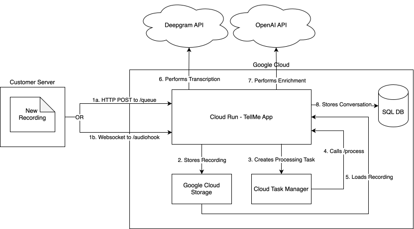

# Call Processing

The Django app `call_processing` is in charge of carrying out the data processing routine visible below:



## Processing Pipeline Overview

The call processing pipeline transforms raw audio recordings into actionable insights through several stages:

### 1. Transcription
- Converts audio files to text using Deepgram SDK
- Supports multiple transcription providers configurable per organization
- Stores full transcript with conversation record

### 2. Topic Association
- AI-powered call categorization using LLM models
- Associates conversations with existing topics
- Can suggest new topics for analyst approval
- Uses organization-specific topic library

### 3. Churn Analysis
- Analyzes customer satisfaction using sentiment scoring (1-5 scale)
- Identifies potential churn risks
- Tracks conversation resolution status
- Monitors revenue at stake

### 4. Summarization
- Generates AI-powered summaries for each conversation
- Creates concise titles for quick reference
- Tracks token usage for cost monitoring
- Uses configurable LLM providers (OpenAI, Groq, Google GenAI)

### 5. Meta-Summarization
Aggregates individual conversation summaries into higher-level insights for Topics, Customers, and Agents.

#### Intelligent Content Selection
The meta-summarization process intelligently chooses between using full conversation transcripts or conversation summaries based on token limits:

1. **Token-Aware Selection**: For each object's conversations, the system counts how many fit within the model's token limit using:
   - Full conversation transcripts (enriched with metadata)
   - Conversation summaries (enriched with metadata)

2. **Optimization Logic**:
   - If transcripts allow ≥ same number of conversations as summaries → **Use transcripts** (higher quality)
   - If summaries allow more conversations → **Use summaries** (broader coverage)

3. **Recency Bias**: Conversations are ordered by date descending (most recent first), ensuring:
   - Latest interactions are prioritized
   - When hitting token limits, you get the N most recent conversations
   - Deterministic, reproducible results (no random sampling)

#### Metadata Enrichment
Both transcripts and summaries are enriched with contextual metadata before meta-summarization:
```
({date}, Sentiment: {sentiment}/5, Revenue at Stake: {revenue}, Resolved: {resolved}) {content}
```

This provides LLMs with critical business context for:
- Customer satisfaction assessment
- Churn risk evaluation
- Revenue impact understanding
- Resolution status tracking

#### Observability
All meta-summarization operations are tracked in Langfuse with metadata including:
- `item_type_used`: "transcripts" or "summaries"
- `transcript_count_possible`: Number of transcripts that fit in token limit
- `summary_count_possible`: Number of summaries that fit in token limit
- Model usage, token counts, and completion details

#### Trigger Behavior
After each conversation is processed, summarization tasks are automatically created for:
- **Topics** associated with the conversation (quarterly, rolling)
- **Customer** involved in the conversation (eternity/full history)
- **Agent** handling the conversation (**currently disabled**)

### 6. LLM Configuration
- Configurable per organization via `enrichment_method`
- Supports multiple providers:
  - OpenAI (GPT-4o, GPT-4o-mini, GPT-5 family)
  - Groq (Llama models)
  - Google GenAI (Gemini 1.5/2.0 via Vertex AI)
- Automatic fallback and retry logic via LiteLLM
- Token limit awareness with 80% safety margin
- Model-specific context window management

## Key Design Principles

### Multi-Tenancy
All processing respects organization boundaries:
- Dedicated service account per environment: `processing.{env}@tell-me.ch`
- Organization-specific configurations for transcription and enrichment
- Isolated data and processing queues

### Asynchronous Processing
- Uses Google Cloud Tasks for background processing
- Enables horizontal scaling of processing workload
- Decouples API response time from processing time

### Cost Optimization
- Token usage tracking at conversation and organization level
- Intelligent selection between transcripts and summaries
- Configurable LLM providers for cost/quality tradeoffs
- Safety margins prevent excessive token usage

### Quality Optimization
- Prefers full transcripts when possible (for customers with few conversations)
- Falls back to summaries for broader coverage when needed
- Recency bias ensures most relevant data is analyzed
- Enriched metadata provides business context to LLMs