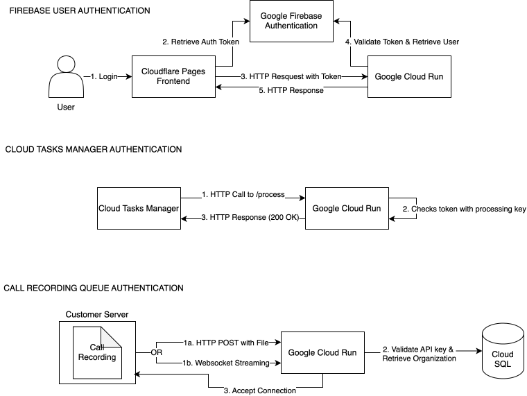

# Authentication

Three different authentication schemes are used in this application:
* User Authentication with Firebase
* Authentication of the Cloud Tasks Manager with a processing key secret
* Authentication of incoming Call Data with an Organization-specific API key

