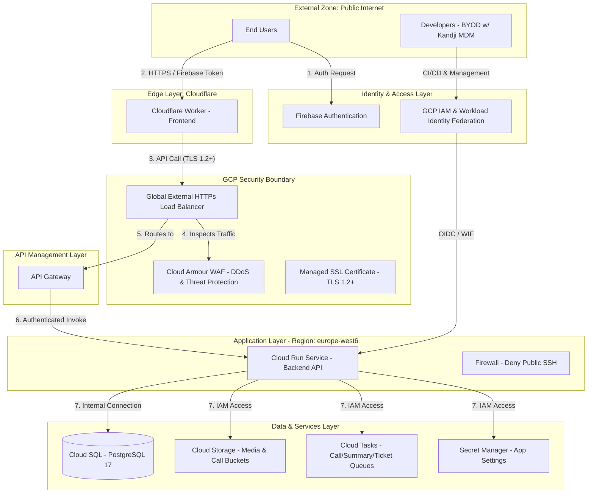

# TellMe Infrastructure & Network Architecture

## Overview

This document provides a detailed network diagram and description of the TellMe infrastructure. The architecture is designed with a serverless-first approach on Google Cloud Platform (GCP) and Cloudflare, prioritizing security controls, data integrity, and high availability to support ISO 27001 and SOC 2 compliance.

## Network Diagram

The following diagram illustrates the boundary definitions, network zones, security controls, and data flows within the environment.

## Architectural Components & Security Controls

### 1. Network Zones & Boundaries

* **External Zone**: Includes end-users and company developers. Developers operate under a "lightweight" BYOD scheme, with security compliance enforced by the **Kandji MDM** platform.
* **Edge Layer**: The application frontend is hosted on **Cloudflare Workers**, providing a globally distributed entry point that minimizes latency.
* **GCP Security Boundary**: All backend traffic is funneled through a **Global External HTTP(S) Load Balancer**. Entry is protected by **Cloud Armour**, which serves as a Web Application Firewall (WAF) to block SQL injection, Cross-Site Scripting (XSS), and malicious IP ranges.
* **Application Layer**: The backend logic is fully containerized and hosted on **Cloud Run (Gen2)** within the `europe-west6` region.

### 2. Security Controls & Redundancy

* **Encryption**: All external communications are encrypted using **TLS 1.2+**. The Load Balancer enforces security headers, including **HSTS**, **X-Content-Type-Options** (nosniff), and **X-Frame-Options** (DENY).
* **Access Control**: User identity is managed via **Firebase Authentication**. Internal service access is strictly governed by **GCP IAM roles**, ensuring that the backend service account has the minimum necessary permissions to access databases, buckets, and secrets.
* **Network Hardening**: To comply with audit requirements, a high-priority firewall rule explicitly **denies public SSH access** (Port 22) across the project.
* **Data Availability & Redundancy**:
  * **Cloud SQL (PostgreSQL 17)**: Configured for high availability (REGIONAL) with automatic failover. Automated daily backups are retained for 30 days, and Point-in-Time Recovery (PITR) is enabled.
  * **Cloud Storage**: Buckets for media and call processing have **versioning enabled** and lifecycle rules to manage data retention.

### 3. Data Flows

* **Request Pipeline**: Upon successful authentication with Firebase, requests from the Cloudflare-hosted frontend reach the GCP Load Balancer. After WAF inspection by Cloud Armour, the **API Gateway** routes authorized requests to the Cloud Run backend.
* **Resource Integration**: The Cloud Run service communicates internally with:
  * **Cloud SQL** via a secure instance connection.
  * **Cloud Tasks** for asynchronous processing of calls, summaries, and tickets.
  * **Secret Manager** for retrieving sensitive environment settings and credentials.
* **Developer/CI Flow**: GitHub Actions utilizes **Workload Identity Federation** to securely deploy infrastructure and code without long-lived secrets.