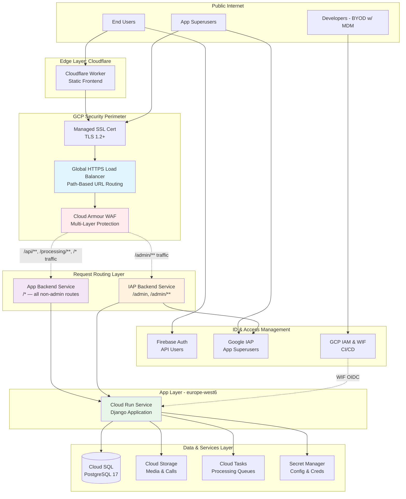

# TellMe Infrastructure & Network Architecture

## Overview

This document provides a detailed network diagram and description of the TellMe infrastructure. The architecture is designed with a serverless-first approach on Google Cloud Platform (GCP) and Cloudflare, prioritizing security controls, data integrity, and high availability to support ISO 27001 and SOC 2 compliance.

## Network Diagram

The following diagram illustrates the boundary definitions, network zones, security controls, and data flows within the environment.

## Architectural Components & Security Controls

### 1. Network Zones & Boundaries

* **External Zone**: Includes end-users and company developers. Developers operate under a "lightweight" BYOD scheme, with security compliance enforced by a **Mobile Device Management (MDM)** platform.
* **Edge Layer**: The application frontend is hosted on **Cloudflare Workers**, providing a globally distributed entry point that minimizes latency.
* **GCP Security Boundary**: All backend traffic is funneled through a **Global External HTTP(S) Load Balancer**. Entry is protected by **Cloud Armour**, which serves as a Web Application Firewall (WAF) to block SQL injection, Cross-Site Scripting (XSS), and malicious IP ranges.
* **Application Layer**: The backend logic is fully containerized and hosted on **Cloud Run (Gen2)** within the `europe-west6` region. Cloud Run ingress is set to `INGRESS_TRAFFIC_INTERNAL_LOAD_BALANCER`, which means the direct Cloud Run service URL is unreachable from the public internet — only traffic arriving via the GCP Global Load Balancer is admitted. All application-level authentication is handled by Django (Firebase JWT, ephemeral tokens, processing pipeline key).

### 2. Security Controls & Redundancy

* **Encryption**: All external communications are encrypted using **TLS 1.2+**. The Load Balancer enforces security headers, including **HSTS**, **X-Content-Type-Options** (nosniff), and **X-Frame-Options** (DENY).
* **Access Control**:
  * **API Access**: User identity for API endpoints is managed via **Firebase Authentication**, validated by Django's `FirebaseAuthentication` class on every request.
  * **Admin Access**: The Django admin interface (`/admin`) is protected by **Google Identity-Aware Proxy (IAP)**, which requires Google account authentication and IAM role membership (`roles/iap.httpsResourceAccessor`). This provides enterprise-grade access control with centralized identity management.
  * **Service Access**: Internal service access is strictly governed by **GCP IAM roles**, ensuring that the backend service account has the minimum necessary permissions to access databases, buckets, and secrets.
* **Web Application Firewall**: **Cloud Armour** provides layered protection with distinct security policies for API and admin traffic:
  * **All Traffic Protection**: Full WAF rule enforcement for every route via the single `api_backend` Backend Service — SQLi, XSS, LFI, RCE, rate limiting, malicious IP blocking, and suspicious user agent detection. `/processing/v1/start` has an additional dedicated rate-limit rule (10 req/min per IP, priority 1050) to prevent ephemeral token generation abuse.
  * **Admin Traffic Protection** (`/admin/**`): Applies all WAF rules **except** SQL injection detection, which is bypassed to prevent false positives on Google IAP's OAuth callback tokens. Admin traffic is still protected by:
    - IP blocking and rate limiting (Priority 200-1150)
    - XSS protection (Priority 1300)
    - LFI protection (Priority 1350)
    - RCE protection (Priority 1360)
    - Large body checks, user agent filtering, HTTP method validation (Priority 1400-1700)
    - **Defense in depth**: IAP authentication + WAF (minus SQLi) + Django security
  * **Adaptive DDoS Protection**: Layer 7 DDoS defense enabled with automatic threat detection and mitigation
* **Network Hardening**: To comply with audit requirements, a high-priority firewall rule explicitly **denies public SSH access** (Port 22) across the project.
* **Data Availability & Redundancy**:
  * **Cloud SQL (PostgreSQL 17)**: Configured for high availability (REGIONAL) with automatic failover. Automated daily backups are retained for 30 days, and Point-in-Time Recovery (PITR) is enabled.
  * **Cloud Storage**: Buckets for media and call processing have **versioning enabled** and lifecycle rules to manage data retention.

### 3. Data Flows

The architecture implements two distinct routing paths based on the request type:

#### API & Processing Request Pipeline (all routes except /admin)
* **Authentication**: Users authenticate via **Firebase Authentication** and obtain a Firebase token. Processing clients obtain a short-lived ephemeral token from `GET /processing/v1/start` using their Organisation API Key.
* **Request Flow**: Requests from the Cloudflare-hosted frontend (or customer servers) reach the GCP Load Balancer.
* **Security Inspection**: Cloud Armour applies WAF rules, rate limits, and DDoS protection before the Load Balancer routes traffic to the **App Backend Service** (direct Cloud Run Serverless NEG).
* **Token Validation**: Django validates every token independently — Firebase JWTs via `FirebaseAuthentication`, ephemeral tokens via `EphemeralTokenAuthentication`, and the processing pipeline key via header comparison.

#### Admin Request Pipeline (/admin, /admin/**)
* **Authentication**: Admin users authenticate via **Google IAP (Identity-Aware Proxy)** using their Google accounts.
* **Request Flow**: Admin requests reach the GCP Load Balancer at the `/admin` path.
* **Layered Security Inspection**: Cloud Armour applies multiple WAF protection layers:
  1. IP blocking and rate limiting checks
  2. XSS, LFI, and RCE attack detection
  3. Large body, user agent, and HTTP method validation
  4. **SQLi checks bypassed** (Priority 1800) to prevent false positives on IAP OAuth tokens
* **Routing**: The **Load Balancer** routes `/admin/**` traffic to the **IAP Backend Service**.
* **IAP Verification**: IAP validates the user's Google identity and checks IAM permissions (`roles/iap.httpsResourceAccessor`) before allowing direct access to Cloud Run.
* **Security Model**: Multi-layer defense combining IAP authentication, selective WAF protection, and Django's built-in security controls.

#### Resource Integration
The Cloud Run service communicates internally with:
  * **Cloud SQL** via a secure instance connection.
  * **Cloud Tasks** for asynchronous processing of calls, summaries, and tickets.
  * **Secret Manager** for retrieving sensitive environment settings and credentials.

#### Developer/CI Flow
GitHub Actions utilizes **Workload Identity Federation** to securely deploy infrastructure and code without long-lived secrets.